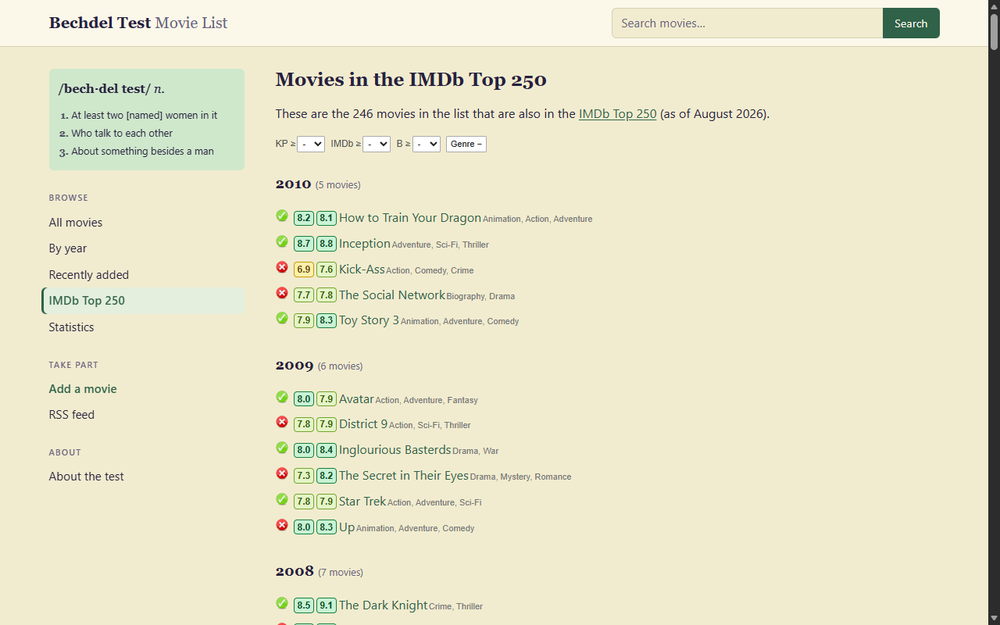

# Bechdel Test for Movie Sites

A Chrome extension that shows [bechdeltest.com](https://bechdeltest.com/)
scores on popular movie sites, and adds IMDb and Kinopoisk ratings, genres and
filters to bechdeltest.com itself.

It is an unofficial project, not affiliated with bechdeltest.com, IMDb or the
other sites.


## Install

- **Chrome Web Store** — coming soon.
- **From a release** — download `bechdel-test-for-movie-sites-*.zip` from the
  [latest release](https://github.com/rrokot/bechdel-test-for-movie-sites/releases/latest),
  unpack it, then open `chrome://extensions`, turn on **Developer mode** and
  choose **Load unpacked**.

It works in Chrome 130 or newer and other Chromium-based browsers.

## On movie sites

Every movie page gets a badge next to its title with the Bechdel Test score
from 0 to 3, linking to the movie on bechdeltest.com. A question mark marks a
3 that contributors dispute. Movies that are not rated yet get a link to add
them.

| Site | Movie pages |
| --- | --- |
| IMDb | `imdb.com/title/…` |
| Kinopoisk | `kinopoisk.ru/film/…`, `/series/…` |
| Letterboxd | `letterboxd.com/film/…` |
| TMDB | `themoviedb.org/movie/…`, `/tv/…` |
| Trakt | `trakt.tv/movies/…`, `/shows/…` |
| Rotten Tomatoes | `rottentomatoes.com/m/…`, `/tv/…` |
| Metacritic | `metacritic.com/movie/…`, `/tv/…` |
| Douban | `movie.douban.com/subject/…` |
| FilmAffinity | `filmaffinity.com/…/film….html` |
| AlloCiné | `allocine.fr/film/fichefilm_gen_cfilm=….html` |
| Filmweb | `filmweb.pl/film/…`, `/serial/…` |

## On bechdeltest.com



- Kinopoisk (KP) and IMDb ratings before each movie title, color-coded and
  linked to the title pages
- Up to three IMDb genres per movie
- Filters by minimum KP rating, IMDb rating and Bechdel score, plus genre
  exclusion; settings sync across tabs and devices

Ratings that are still loading or failed to load never hide a movie.

## How it works

**Bechdel scores.** bechdeltest.com has no API, so the extension keeps a local
copy of its movie list (about 11,000 movies). The first sync downloads the 55
list pages; after that a daily sync reads the sitemap and downloads only the
pages whose date changed.

**Matching movie sites.** Each site identifies a movie by its own ID in the
URL. Wikidata maps that ID to an IMDb ID (cached for 30 days), and the IMDb ID
finds the movie in the local copy. Letterboxd and Douban pages also show the
IMDb ID themselves, which is used when Wikidata has no mapping.

**Ratings on bechdeltest.com.**

- IMDb GraphQL provides IMDb ratings and genres for the whole page in one
  request.
- Wikidata resolves IMDb IDs to Kinopoisk IDs in one request.
- The public Kinopoisk XML rating widget provides KP ratings.
- When Wikidata has no Kinopoisk ID, the extension searches Kinopoisk by the
  IMDb title and year, then by title alone allowing a one-year difference. A
  result is accepted only when its normalized title, year and director match
  the IMDb metadata. Ambiguous results stay unresolved.
- Ratings are cached for seven days, missing ratings for one day. Failed
  requests are not cached and are retried on the next visit.

Kinopoisk pages are requested with the browser's Kinopoisk cookies. If
Kinopoisk asks for a captcha or a sign-in check, open
[kinopoisk.ru](https://www.kinopoisk.ru/) once and reload the page.

The toolbar popup shows the state of the local copy, syncs it on demand and
clears the ratings cache.

## Privacy

No account, no tracking, no servers of its own. The extension only sends movie
IDs and titles to the rating sources above and keeps everything else in Chrome
storage on your device. See the [privacy policy](PRIVACY.md).

## Development

Requires Node.js 24 or newer.

```sh
npm install
npm run build   # build into dist/
npm run watch   # rebuild on source changes
npm run check   # type-check
npm test        # unit tests
npm run zip     # build a Chrome Web Store package
```

Load `dist/` via `chrome://extensions` → **Developer mode** → **Load
unpacked**. After `npm run watch` rebuilds, press the reload button on the
extension card. Changes in `static/` or the manifest need a full
`npm run build`.

The manifest is generated by `src/manifest.ts`: site hosts come from
`src/catalog/sites.ts`, fetch hosts from `src/shared/config.ts`, and the
version from `package.json`. Adding a movie site means adding one entry to
`SITES`.

Releases are published to the Chrome Web Store from CI; see
[docs/releasing.md](docs/releasing.md).

## License

[MIT](LICENSE)
